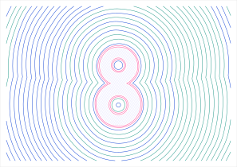
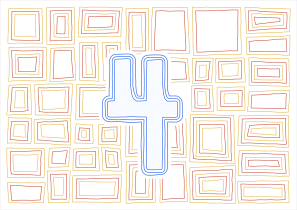

# PlotterNodes

Zero-touch nodes for [Dynamo](https://github.com/DynamoDS/Dynamo) that turn any closed curves into pen plotter drawings in the style of the reference "numbers" images: a bold numeral in the middle, concentric halo rings radiating from it, and a hand-drawn background texture (nested rectangles, bull's-eye circles, framed ovals, spirals). Output is a layered SVG that the AxiDraw software plots directly, one layer per pen.

 

## How it works

1. **Curves in.** `Shape.ByCurves` takes Dynamo curves (circles, polycurves, imported outlines, text outlines from any source) and flattens them to a 2D `Shape`: a set of closed loops filled with the even-odd rule, so the counters of a 6, 8 or 9 are holes automatically.
2. **Distance fields instead of curve offsets.** Every offset, ring, boolean and clip goes through a sampled signed distance field (`DistanceField`). Offsetting is then just tracing a contour at a different level, which is robust for any input and gives the characteristic behaviour of the reference images: separate parts merge into one outline as the rings grow, and holes close up as they shrink.
3. **Hand-drawn quality.** `Wobble` displaces outlines sideways with seamless noise; `DistanceField.Perturb` wobbles a whole family of rings coherently; pattern generators jitter their cells.
4. **Pens and paper.** `Layer.ByGeometry` groups geometry per pen, `Drawing.ByLayers` adds the page, `Drawing.Optimize` sorts strokes to minimise pen-up travel, and `Drawing.ExportSvg` writes an Inkscape-layered SVG with AxiDraw layer names (`1-blue`, `2-red`, ...).

All geometry lives in the Dynamo XY plane in drawing units (millimetres by default), Y up, origin at the bottom-left of the page. The exporter flips Y for SVG.

## Node reference

Category **Plotter** in the Dynamo library.

| Class | Create | Actions | Queries |
|---|---|---|---|
| **Shape** | `ByCurves` (Dynamo curves), `ByPoints`, `ByPolylines`, `ByCoordinates`, `ByBounds`, `Rectangle`, `Circle`, `Ellipse`, `RegularPolygon`, `Combine`, `Union` | `Offset`, `Rings`, `InnerRings`, `Difference`, `Intersection`, `Wobble`, `Simplify`, `Smooth`, `Resample`, `Translate`, `Scale`, `Rotate`, `Hatch`, `Clip`, `FillHoles`, `HolesOnly`, `Contains`, `SignedDistance`, `Bounds`, `Center`, `ToPolyCurves` | `Loops`, `LoopCount`, `Area`, `Perimeter` |
| **Polyline** | `ByCurve` (Dynamo curve), `ByPoints`, `ByCoordinates`, `Line`, `Arc`, `Spiral`, `Wave`, `Join` | `Outline` (thick stroke to Shape), `Wobble`, `Simplify`, `Smooth`, `Resample`, `Reverse`, `Close`, `Open`, `Translate`, `Scale`, `Rotate`, `Bounds`, `PointAtParameter`, `ToPolyCurve` | `IsClosed`, `PointCount`, `Length`, `Coordinates`, `Points` |
| **DistanceField** | `ByShape`, `ByPolylines` | `Contour`, `Contours`, `Union`, `Intersection`, `Difference`, `SmoothUnion`, `Offset`, `Invert`, `Perturb`, `Sample`, `Bounds` | `Resolution` |
| **Pattern** | `NestedRectangles`, `Grid`, `Circles`, `Spirals` | | |
| **Layer** | `ByGeometry` | `Optimize`, `WithAxiDrawOptions` | `Name`, `PenNumber`, `Color`, `StrokeWidth`, `Polylines`, `PathCount`, `DrawLength`, `TravelLength`, `SvgLabel` |
| **Drawing** | `ByLayers` | `ExportSvg`, `ToSvg`, `Optimize`, `Statistics` | `Width`, `Height`, `Units`, `Layers`, `PageShape` |
| **Page** | `Size` (A-series, Letter, Tabloid, AxiDraw travel), `Region`, `Fit` | | |
| **Noise** | `Value`, `Fractal`, `Loop` | | |
| **Make2D** | `ByDirection` (parallel), `ByPlane` (parallel onto a Dynamo plane), `ByCamera` (perspective) | `Bounds`, `ToPolyCurves` | `VisibleLines`, `HiddenLines`, `Silhouettes`, `Creases`, `Curves`, `Frame`, `TriangleCount` |

Pattern generators return one sub-list per cell, ordered from the outer ring inwards, so rings can be dealt to different pens by index (`List.Transpose`, `List.GetItemAtIndex`). Every generator takes a `seed`, an optional `avoid` shape (the numeral) and an `avoidMargin`.

Typical graph:

```
curves -> Shape.ByCurves -> Shape.Union (if parts overlap) -> Shape.Combine (add counters)
       -> Shape.Rings / Pattern.* -> Shape.Clip (page region, keepInside) and halo.Clip (pattern, keepOutside)
       -> Shape.Wobble -> Layer.ByGeometry (per pen) -> Drawing.ByLayers -> Drawing.Optimize -> Drawing.ExportSvg
```

`samples/PlotterNodes_Numeral8.dyn` is exactly that graph, built from four Dynamo circles.

## Make2D: hidden-line drawings of 3D geometry

`Make2D` does what Rhino's Make2D command does: it projects solids, surfaces, polysurfaces, meshes and curves onto an image plane and splits the resulting lines into the parts that are visible from the viewpoint and the parts hidden behind other geometry. ProtoGeometry/ASM exposes no silhouette or hidden-line function, so the whole thing is mesh based and lives in `Internal/HiddenLine.cs` with no dependency on the geometry kernel:

1. Solids and surfaces are meshed with Dynamo's `Mesh.ByGeometry` (`meshTolerance` controls the faceting; `-1` lets Dynamo choose). Meshes are used as they are, curves are sampled in 3D.
2. Vertices are welded, the winding made consistent, and every mesh edge classified: *boundary* (one face), *crease* (dihedral angle above `creaseAngle`), *silhouette* (front face meets back face) or smooth (not drawn). Edges that only exist because two adjacent faces were tessellated differently (T-junctions) are matched to their partners, so smooth surfaces stay clean.
3. Everything is projected (parallel, or perspective with frustum clipping), lines are split where they cross other lines in the drawing, and the midpoint of each piece is depth tested against a grid of projected triangles.
4. Pieces are deduplicated (hidden lines coincident with visible ones are dropped, as in a plan view of a box), chained into polylines and simplified.

`Make2D.ByDirection(geometry, viewDirection, upVector)` is the Top/Front/isometric case: `(0,0,-1)` is a plan view, `(-1,-1,-1)` an isometric. `Make2D.ByPlane` projects onto a Dynamo plane and uses its origin and axes as the drawing frame (Rhino's "Current CPlane"). `Make2D.ByCamera(geometry, eyePoint, targetPoint, upVector, fieldOfView, imagePlaneDistance)` is a perspective: lines are drawn where they pierce the image plane, so geometry at `imagePlaneDistance` (default: the eye-target distance) appears at true size, and `fieldOfView` clips to the square window returned by `Frame`. Outputs are `Polyline` lists in drawing coordinates (x right, y up, origin at the projected world origin or camera target), ready for `Polyline.Translate`, `Page.Fit` and `Layer.ByGeometry`; `Silhouettes`, `Creases` and `Curves` split the visible lines by origin so outlines and interior edges can get different pens.

`samples/Make2D_Scene.dyn` (generated by `tools/make_make2d_graph.py`) draws a cuboid, cylinder, sphere, cone and a free line twice, isometric and perspective, with visible and hidden lines on separate pens. The headless `tools/Smoke` run checks the engine on synthetic meshes (box, T-junctions, inconsistent winding, cylinder, sphere, torus, curves through solids, perspective clipping) and writes `make2d_iso.svg` and `make2d_perspective.svg`.

Limits: accuracy is that of the mesh (raise the resolution if curved silhouettes look faceted); tangent edges of a polysurface are not drawn (they are smooth in the mesh), and intersections between interpenetrating solids are not created, exactly as in Rhino.

## Numeral samples 0 to 9

`samples/Numerals/Numeral_0.dyn` ... `Numeral_9.dyn` each recreate the style of one reference image. Rendered previews are in `samples/Numerals/preview/`.

| Graph | Numeral built from | Background | Pens |
|---|---|---|---|
| 0 | one ellipse centre line | bull's-eye circles, concentric ovals in the counter | orange, pink, rust, fill |
| 1 | closed rectangle outline | grid of nested squares | blue, green, pink, fill |
| 2 | bowl arc, diagonal, base line | large hand-cut nested patches | orange, pink, green, fill |
| 3 | two arcs | bull's-eyes around a scalloped (flower) halo | green, blue, yellow-green, pink, fill |
| 4 | three overlapping rectangles, fused | patchwork of nested rectangles | yellow, red, blue, fill |
| 5 | top bar, upright, bowl arc | grid of framed ovals, triple outline | pink, red, green, light blue, fill |
| 6 | circle and tail arc | thick spiral scrolls, rings in the counter | blue, light blue, navy, fill |
| 7 | top bar and diagonal | grid of three-ring square frames | pink, yellow, red, green, fill |
| 8 | two circles | wobbling contours across the whole page | blue, green, teal, fill |
| 9 | circle and stem | columns of framed ovals between thick bars | navy, green, blue, yellow, fill |

Every graph has three groups: **1. Numeral from Dynamo curves** (edit the first code block: any curves work), **2. Background pattern** (seeds, cell sizes and ring gaps sit in the code blocks beside each node), **3. Pens, page and AxiDraw SVG** (one Layer per pen; set the path in the String node, default `D:\Drawing\PlotterNodes\output\numeral_N.svg`, then press Run; graphs open in Manual run mode).

Two ways of turning curves into a numeral are shown. Most graphs give stroke centre lines (Line, Arc.ByThreePoints, Circle, Ellipse) to `Polyline.ByCurve` and `DistanceField.ByPolylines`, then `Contour` at half the stroke width, which yields chunky rounded strokes with counters cut automatically. Graphs 1 and 4 give closed outlines to `Shape.ByCurves` and fuse them with `Shape.Union`. Pens are dealt from the pattern rings with `Pattern.SelectRings`, and backgrounds are kept clear of the numeral with the `avoid` input plus `Shape.Clip`.

The graphs are generated by `tools/make_numeral_graphs.py` from one recipe per numeral, using node signatures read from the compiled DLL (`tools/plotter_api.json`, written by `tools/ApiDump`). The same recipes produce `tools/NumeralPreview`, which renders the graphs headlessly; `build.ps1 -Smoke` runs it.

## Installing

Download `PlotterNodes-<version>.zip` from the [Releases page](https://github.com/kronz/PlotterNodes/releases), unzip it, and copy the `PlotterNodes` folder into `%APPDATA%\Dynamo\Dynamo Core\<version>\packages`. Restart Dynamo.

Maintainers: run `tools\make_release.ps1 -Publish` to build the package and create the release.

## Building

Requirements: the .NET SDK matching your Dynamo (net10.0 for Dynamo 4.x, net8.0 for Dynamo 3.x). Visual Studio is optional; everything is `dotnet build`.

```powershell
# 1. Against your local Dynamo build (recommended when running Dynamo from source)
.\build.ps1 -DynamoBinDir D:\Drawing\Dynamo\bin\AnyCPU\Release -Install

# 2. Against the public NuGet package (DynamoVisualProgramming.ZeroTouchLibrary 4.2.1.5887)
.\build.ps1 -Install

# 3. Dynamo 3.x host
.\build.ps1 -DotNet net8.0 -DynamoNuGetVersion 3.4.2.7731 -Install

# Headless smoke test and example SVGs (no Dynamo binaries needed, uses the Dynamo repo sources for the shim)
.\build.ps1 -Smoke -DynamoRepo D:\Drawing\Dynamo
```

The build assembles a ready-to-load package at `package\PlotterNodes\` (`pkg.json`, `bin\PlotterNodes.dll` + `.xml` for tooltips, `extra\` with the sample graph). `-Install` copies it to `%APPDATA%\Dynamo\Dynamo Core\<newest version>\packages\PlotterNodes`; pass `-PackagesDir` for Revit or Civil 3D package folders. Restart Dynamo and look for the **Plotter** category.

Dynamo's own assemblies (`DynamoServices.dll`, `ProtoGeometry.dll`) are referenced with `Private=false` / `ExcludeAssets=runtime` so they are never copied into the package, which would break loading.

## Project layout

```
src/PlotterNodes/           the node library (C#, no dependencies beyond DynamoServices + ProtoGeometry)
  Shape.cs, Polyline.cs     public node classes
  DistanceField.cs          sampled SDF, contouring, booleans
  Pattern.cs                background generators
  Layer.cs, Drawing.cs      pens, SVG writer, path ordering
  Page.cs, Noise.cs         paper sizes, fitting, noise
  Make2D.cs                 hidden-line drawings (node class; Dynamo factories live in DynamoGeometry.cs)
  DynamoGeometry.cs         ProtoGeometry interop (compiled only with DYNAMO_GEOMETRY)
  Internal/                 Vec2/Vec3, KD-tree distance queries, marching squares, Douglas-Peucker, chaining,
                            HiddenLine.cs (mesh based hidden line removal)
  pkg.json                  package manifest (node_libraries lists the assembly full name)
tools/Smoke/                headless checks + example compositions (eight, four, ten, nine, six)
tools/DynamoServicesShim/   compiles Dynamo's Attributes.cs + GraphicsDataInterfaces.cs for headless builds
tools/make_sample_graph.py  generates samples/PlotterNodes_Numeral8.dyn (validated against doc/dyn-file-spec.json)
tools/make_make2d_graph.py  generates samples/Make2D_Scene.dyn
tools/hlr_prototype/        Python mirror of Internal/HiddenLine.cs used to validate the algorithm (python test_hlr.py renders out/*.png)
samples/                    sample graph and example SVG output
build.ps1                   build / package / install / smoke
```

## Zero-touch conventions used

- Public static methods become Create/Action nodes, instance methods become Action nodes with the object as first input, public properties become Query nodes. Namespace `Plotter` is the library category; constructors are internal so only `By...` factories appear.
- XML doc comments supply tooltips and `<search>` tags; `PlotterNodes.xml` ships next to the DLL.
- `[MultiReturn]` + `Dictionary<string, object>` for multi-output nodes (`Bounds`, `Statistics`, `Page.Size`).
- `[ArbitraryDimensionArrayImport]` on `IList<object>` inputs (`Layer.ByGeometry`, `Shape.Clip`, `Page.Fit`) so nested lists arrive whole instead of being replicated over.
- `[DefaultArgument("null")]` for optional `avoid` shapes; C# default values for everything else.
- `Shape`, `Polyline`, `Layer` and `Drawing` implement `IGraphicItem` so they draw in the background preview (layers in their pen colour). `Tessellate` is hidden with `[IsVisibleInDynamoLibrary(false)]`.
- No ProtoGeometry objects are stored on returned objects, so `[KeepReference]` is not needed; transient Dynamo points and sub-curves are disposed immediately.

## AxiDraw notes

- Layers are `<g inkscape:groupmode="layer" inkscape:label="1-name">`. The AxiDraw software plots layers in ascending number from the Layers tab / `layers` mode, and reads `+S` (speed), `+H` (pen height) and `+D` (delay) codes from the name; `Layer.WithAxiDrawOptions` appends them. `%page` is a documentation layer and is skipped.
- `width`/`height` carry units and the `viewBox` matches, so one drawing unit is one millimetre (or inch).
- `Drawing.Statistics` reports pen-down length and pen-up travel; `Optimize` typically cuts travel by two thirds on pattern-heavy drawings.
- Resolution defaults (0.25 mm) are below pen width. For A3 halo fields across the whole page use 0.3 to 0.5 mm; the field caps itself at 6 million samples and coarsens automatically beyond that (`DistanceField.Resolution` tells you what was used).

## Limitations and next steps

- Booleans and offsets are field based: accuracy is bounded by the resolution (plus `simplifyTolerance`), which is ideal for plotting but not for CAD-exact geometry.
- `Pattern.NestedRectangles` uses convex insets; very large `jitter` values relative to the cell size are clamped to keep cells convex.
- Not yet built: text to outlines (bring curves from any text source), a double-spiral "scroll" primitive, per-stroke pressure/width variation, and a direct `axicli` runner node.


**Build 
cd D:\Drawing\PlotterNodes
.\build.ps1 -DynamoBinDir D:\Drawing\Dynamo\bin\AnyCPU\Release -Install

