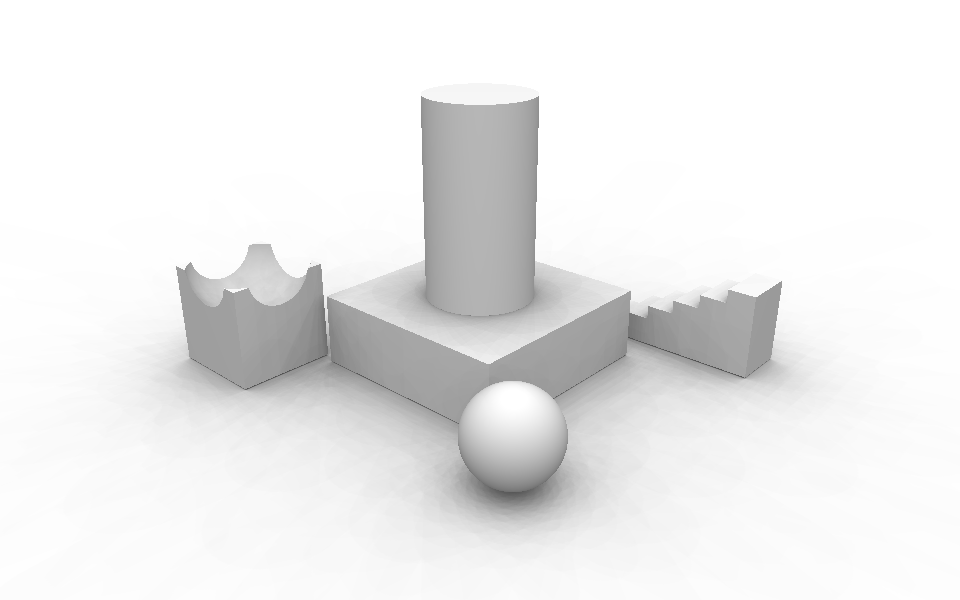

# Canvas 3D: a separate 3D window with Arctic display

`Plotter > View > Canvas 3D` is a Watch3D-style node whose preview lives in its own top-level
window instead of inside the node. Everything wired into the node is drawn there; the input is
passed through to the output. Put the window on a second monitor, maximize it or make it full
screen, and switch between Dynamo's own shading and **Arctic** display: white materials, a white
background, soft shadows from an overcast sky on an automatic ground plane, and ambient
occlusion, like Rhino's Arctic display mode.



*CPU reference of the Arctic sky shadows (`tools/arctic_prototype/arctic_reference.py`, Medium
quality, no screen-space AO) on the scene of `samples/Canvas3D/Canvas3D_Arctic.dyn`.*

## Build and install

The node is a second assembly in the PlotterNodes package, `PlotterNodes.Canvas.dll`
(`src/PlotterNodes.Canvas`, WPF, net10.0-windows). `build.ps1` builds it after PlotterNodes in
both reference modes:

```powershell
.\build.ps1 -DynamoBinDir <Dynamo bin folder> -Install   # DynamoCoreWpf, HelixToolkit and SharpDX from your Dynamo build
.\build.ps1 -Install                                      # NuGet: DynamoVisualProgramming.WpfUILibrary + HelixToolkit 2.24.0
.\build.ps1 -SkipCanvas                                   # PlotterNodes only
```

`-DynamoBinDir` needs a full `Dynamo.All.sln` build (it checks for `DynamoCoreWpf.dll`,
`HelixToolkit.SharpDX.Core.Wpf.dll` and `SharpDX.D3DCompiler.dll`). Nothing from Dynamo, Helix or
SharpDX is copied into the package. The shaders are HLSL sources embedded in the DLL and
compiled when the first window opens, with `d3dcompiler_47.dll` from Windows, so no Windows SDK
or fxc is needed. `pkg.json` lists the new assembly in `node_libraries`.

## Use

Place `Canvas 3D`, wire geometry into it and run. The window opens maximized on a different
display than Dynamo's (on the same display when there is only one) and reopens where it was when
the graph is opened again. In the node: **Show canvas** (or **Bring to front**) and an **Arctic**
toggle; the node's context menu has **Show canvas window** and **Move canvas window to another
display**. Several Canvas 3D nodes give several windows.

| In the window | |
|---|---|
| Right drag | Orbit (turntable) |
| Middle drag, Shift+right drag | Pan |
| Wheel, Ctrl+right drag | Zoom (around the mouse) |
| Ctrl+Shift+right drag | Zoom to rectangle |
| Left click | Select the node that made the geometry |
| F, Ctrl+E | Zoom to fit: the selected nodes' geometry in this canvas, or everything in it |
| A | Shaded / Arctic |
| F11, Esc | Full screen on the current display, leave full screen |

Toolbar: **Shaded**, **Arctic**, **Zoom to fit**, **Display** (move to a display and maximize),
**Full screen**, **Keep on top**, **Camera** (follow, copy or send the background preview camera,
reset), **Settings** (the panel on the right). Closing the window by hand keeps it closed for that
graph; **Show canvas** opens it again.

Saved with the node (`Settings` in the .dyn): window placement in physical pixels (restored only
if that display still exists), full screen, keep on top, display mode, camera, grid and view cube,
the camera link and all Arctic settings. Changing a display setting marks the graph as changed;
moving the camera or the window does not (like the background preview camera), but both are
saved with the next save. The settings travel with copy and paste (the pasted canvas opens its
own window) and come back when you undo a delete. Display edits are not undo steps, so undoing
something else never reverts them.

The node's output is the input, unchanged. A Watch3D (or another Canvas 3D) wired to the output
shows that geometry; the background preview does not show it twice.

## Arctic settings

| Setting | Default | |
|---|---|---|
| Material | Arctic white `#EEEEEE` | One color for every object |
| Background | White | The ground plane takes the same color outside its shadows |
| Use object colors | Off | Keep Dynamo display colors (vertex colors, color maps). Off: curves and edges are black (selection, grid and axes keep their colors) |
| Sky light | 1.00 | Overcast sky on upward facing surfaces |
| Ground bounce | 0.45 | Light from below on downward facing surfaces |
| Fill light | 0.18 | Soft light from the camera; separates faces the sky lights equally |
| Exposure | 1.00 | Overall brightness |
| Sky shadows, quality | On, Medium | Draft 64 directions (32 MB), Medium 128 (144 MB), High 192 (384 MB), Ultra 256 (512 MB of video memory) |
| Ground plane, ground shadows | On, 0.70 | Shadow-catching plane just below the lowest object |
| Screen-space ambient occlusion | On, 0.75, 2.5% | Strength and radius (share of the scene size) |

The shadow maps of one quality level are a single texture array, and Direct3D 11 limits one
resource to a quarter of the dedicated video memory (at least 128 MB, at most 2 GB). On a GPU
where the chosen quality does not fit (Medium below 640 MB of dedicated video memory, as on many
integrated GPUs; Ultra below about 2.2 GB),
the canvas lowers the map resolution first and then the number of directions, and the status
line says what it uses, for example "Sky shadows: 128 directions at 576 px (reduced to fit this
GPU)". If the maps cannot be created at all, sky shadows switch off with a message in the status
line and the Dynamo console; choosing another quality tries again. Switching sky shadows off
frees their video memory; Shaded mode keeps them so that switching back is instant.

Frozen nodes and the geometry dimmed by Dynamo's isolation mode still cast sky shadows.

## How it works

### The window and its scene

Dynamo's 3D views are built on HelixToolkit.SharpDX 2.24 (`DynamoCoreWpf/ViewModels/Watch3D`):
`HelixWatch3DViewModel` turns render packages into Helix elements (`DynamoGeometryModel3D`,
`DynamoLineGeometryModel3D`, `DynamoPointGeometryModel3D`, labels, a head light, grid and axes),
and `Watch3DView` shows them in a `Viewport3DX` whose `DynamoEffectsManager` holds Dynamo's own
shaders. Watch3D nodes use a subclass of the same view model.

`CanvasWatch3DViewModel` is such a subclass, rebuilt from the public and protected members only so
that it works from a package: it requests render packages from the nodes wired into the canvas
(forced, ignoring their preview toggle, like Watch3D) and keeps Dynamo's handling of selection
highlight, frozen nodes, labels, instancing and color maps. `CanvasWindow` is a WPF window without
owner (own taskbar button) with a `Viewport3DX` that renders the view model's `SceneItems`. Window
placement uses Win32 (`EnumDisplayMonitors`, `GetWindowPlacement`/`SetWindowPlacement`,
`SetWindowPos`) so moving between monitors with different scaling is exact. `CanvasWindowManager`
owns the windows: they outlive the node view (Dynamo unloads node views when a custom node
workspace is opened) and close with the node, the workspace or Dynamo.

### Arctic rendering

Dynamo meshes look up their render technique by name, `DynamoMeshShader`. The canvas window
replaces that one technique in its own effects manager (`Rendering/ArcticTechniques.cs`), so
Dynamo's meshes render differently in the canvas only, and Dynamo keeps building the scene. The
replacement technique has three passes:

1. **Default**: `vsCanvasMesh` + `psCanvasMesh`. With Arctic off it is a line-by-line port of
   Dynamo's `psDynamoMesh` (head light, selection color, frozen and isolated transparency). With
   Arctic on: albedo = material color, light = sky light x sky irradiance + ground bounce x
   (1 - n.y)/2 + fill light x n.v, times screen-space AO, times exposure.
2. **MeshSSAOPass**: Helix's own normal/depth pre-pass, so Helix's SSAO (`Viewport3DX.EnableSSAO`,
   radius scaled to the scene) sees Dynamo meshes.
3. **PlotterCanvasSkyDepth**: one sky shadow map slice (below).

**Sky shadows** (`Rendering/SkyOcclusion.cs`) follow the idea of Rhino's skylight shadows. The
overcast sky (CIE overcast radiance, (1 + 2 sin(elevation)) / 3) is sampled from N directions on a
Fibonacci spiral above 7 degrees elevation. For each direction the Dynamo meshes are rendered once
into a slice of an R16 texture array: an orthographic depth map along that direction, fitted to the
bounds of all meshes, with a separate D32 depth buffer so Dynamo's per-mesh depth bias cannot shift
the stored depths. The maps depend on the geometry only, not on the camera, so they are rebuilt
when the meshes change (12 slices per frame, in bit-reversed order so the image converges evenly),
and orbiting costs nothing extra. The mesh and ground pixel shaders integrate visibility x cosine x
radiance over all maps (`SkyIrradiance` in `ArcticCommon.hlsli`) with hardware 2x2 PCF, a normal
offset and a slope-scaled depth bias. That gives the soft contact shadows on the ground and the
large-scale occlusion (inside the bowl, under overhangs); SSAO adds the small-scale crease
darkening.

**Ground plane** (`Rendering/GroundPlaneNode.cs`, `psGround.hlsl`): a large quad 0.2% of the scene
size below the lowest object. It draws the background color times its sky visibility, so only the
shadows show; SSAO on it fades out away from the scene, and it disappears when the camera is below it.

A pre-processing scene node uploads the Arctic constants (`cbArctic`, b10) each frame and binds
the shadow array (t35) and its samplers (s10, s11), the way Helix's own SSAO binds its map; Helix
2.24 uses b0-b9, t0-t33 (sparsely), t40+ and s0-s9. It unbinds the array before rendering new
slices into it.

Failure handling. Helix creates techniques, input layouts and shaders lazily inside a frame, where
an exception stops the viewport, so `ArcticTechniques` first creates every technique and pass
under a probe name and replaces Dynamo's technique only when that works; a failing optional pass
(SSAO pre-pass, sky depth) is left out with a message in the Dynamo console. The compiled
shaders' `cbArctic` and `cbArcticLight` sizes are checked against the C# layout by reflection,
and the sky node checks the size of the pooled constant buffers (Helix's pool does not compare
sizes when a buffer of the same name already exists). If the shaders do not compile, the window
stays in Dynamo shading and the toolbar says why; if the sky shadows fail at run time they switch
off and the rest keeps rendering.

The ground plane has no bounds (`HasBound = false`), so Helix's own zoom extents ignores it;
zoom to fit is the canvas view model's own (`CanvasWatch3DViewModel.ZoomToFit`), because
Dynamo's falls back to a fixed default box when the selected nodes are not in the canvas.

## Verification done so far

- **C#**: `tools/CanvasCompileCheck` compiles all of `src/PlotterNodes.Canvas` against stubs of the
  exact Dynamo, Helix 2.24, SharpDX, WPF and Json.NET members it uses, with the real accessibility
  (`check.sh`, Linux sandbox with .NET 8). It caught the `internal` DynamoSelection and confirms the
  `protected` overrides of Dynamo's `protected internal` members. It is not a Windows build.
- **Independent review**: a second pass over the code against the Dynamo, Helix 2.24 and SharpDX
  sources led to the zoom, failure handling, video memory, undo and Watch3D behavior described above.
- **HLSL**: the five shaders pass glslang's HLSL front end (same script). fxc-specific rules are
  only checked at run time (errors appear in the toolbar and the Dynamo log).
- **Sky shadow math**: `tools/arctic_prototype/arctic_reference.py` mirrors direction sampling,
  frame fitting, R16 quantization, PCF and biases on an analytic scene. Against ray-cast visibility
  the shadow maps are off by 0.1% on average (99th percentile 2%); direction sampling leaves about
  0.7% rms banding at 128 directions (1.5% at 48, which looked streaky).

Not done: compiling against the real assemblies, compiling the shaders with d3dcompiler, and
looking at it on a GPU. First things to check on Windows: `.\build.ps1 -DynamoBinDir ... -Install`,
open `extra\Canvas3D\Canvas3D_Arctic.dyn` from the package, and watch the Dynamo console for
"Canvas 3D" messages.

## Files

| | |
|---|---|
| `src/PlotterNodes.Canvas/Canvas3D.cs`, `CanvasSettings.cs` | NodeModel (pass-through) and its saved settings |
| `Canvas3DViewCustomization.cs` | In-node buttons, context menu, `CanvasWindowManager` |
| `CanvasWatch3DViewModel.cs` | Dynamo preview view model for the wired-in nodes |
| `CanvasWindow.cs`, `ArcticPanel.cs`, `CanvasUi.cs` | Window, settings panel, controls (no compiled XAML) |
| `Interop/DisplayMonitors.cs` | Monitors, placement, moving between displays |
| `Rendering/` | Techniques, shader compiler, sky occlusion, ground plane, camera math |
| `Shaders/` | HLSL; `Shaders/Helix` are the unchanged Helix 2.24 headers |
| `samples/Canvas3D/Canvas3D_Arctic.dyn` | Sample (generated by `tools/make_canvas_graph.py`) |
| `tools/CanvasCompileCheck/`, `tools/arctic_prototype/` | Sandbox compile check, CPU reference |
